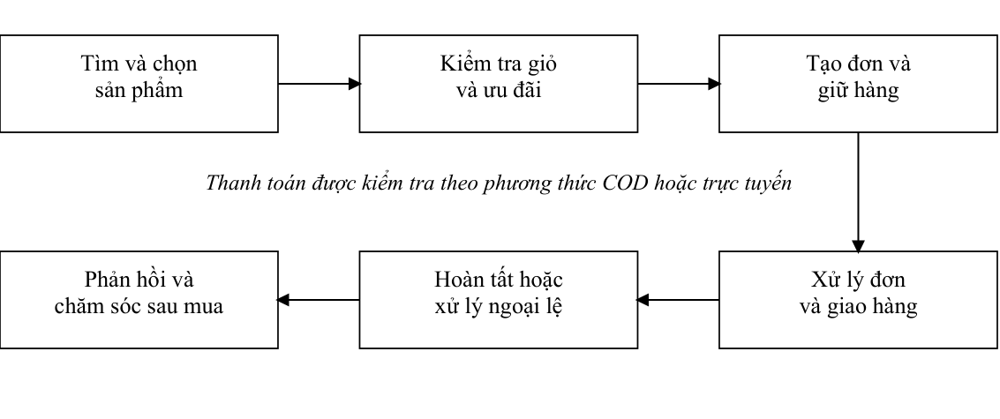
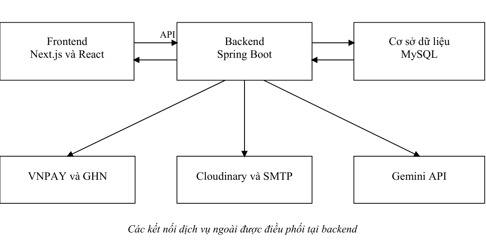
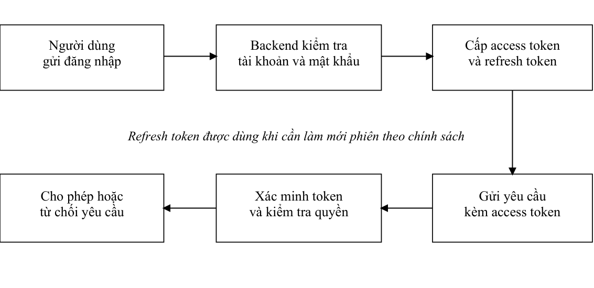
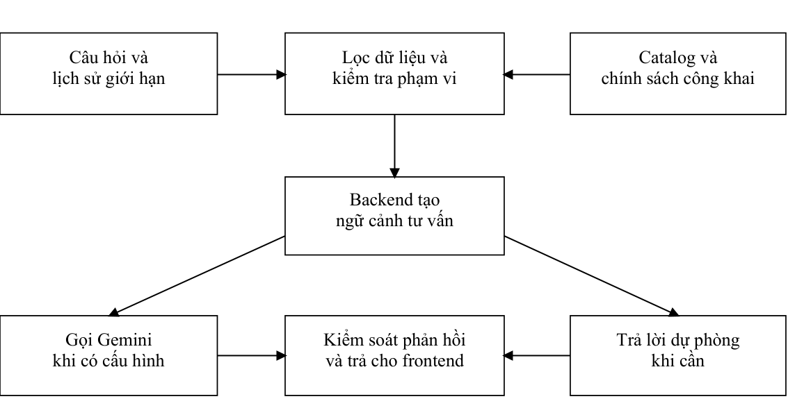

# CHƯƠNG 1 TỔNG QUAN ĐỀ TÀI

## 1.1 Lý do chọn đề tài

Trong những năm gần đây, thương mại điện tử tạo điều kiện để người tiêu dùng tìm kiếm và đặt mua hàng hóa qua các nền tảng trực tuyến. Với nông sản, việc cung cấp thông tin sản phẩm rõ ràng, cập nhật tình trạng còn hàng và hỗ trợ quy trình đặt hàng thuận tiện có thể giúp kết nối người bán với khách hàng hiệu quả hơn. Tuy nhiên, hoạt động kinh doanh nông sản vẫn có những đặc thù như sản phẩm đa dạng, số lượng tồn kho thay đổi và yêu cầu giao nhận phù hợp.

Khi quy trình bán hàng được xử lý qua nhiều kênh riêng lẻ, thông tin về sản phẩm, khách hàng, giỏ hàng và đơn hàng có thể bị phân tán. Việc cập nhật dữ liệu thủ công cũng gây khó khăn cho người quản lý trong việc theo dõi danh mục, giá bán và tồn kho. Về phía khách hàng, quá trình tìm kiếm sản phẩm, lưu lựa chọn, cung cấp địa chỉ giao hàng và theo dõi đơn hàng cần được tổ chức liền mạch trên cùng một nền tảng.

Từ những nhu cầu đó, đề tài GreenFarm được thực hiện nhằm xây dựng một hệ thống web hỗ trợ kinh doanh nông sản trực tuyến. Hệ thống kết hợp tìm kiếm sản phẩm, giỏ hàng, đặt hàng, thanh toán và theo dõi đơn; đồng thời hỗ trợ cửa hàng quản lý tài khoản, hàng hóa, kho theo lô và quá trình giao nhận. Các chức năng đánh giá, tích điểm, liên hệ và trợ lý tư vấn bổ sung cho trải nghiệm mua hàng.

Đề tài cũng là cơ hội vận dụng kiến thức về phân tích và thiết kế hệ thống, phát triển ứng dụng web, cơ sở dữ liệu, xác thực, phân quyền và xử lý giao dịch trong một sản phẩm có quy trình nghiệp vụ thực tế.

## 1.2 Tổng quan về thương mại điện tử nông sản và thực trạng quản lý

Thương mại điện tử cho phép người bán giới thiệu sản phẩm và tiếp nhận đơn đặt hàng thông qua môi trường trực tuyến. Đối với nông sản, một nền tảng bán hàng cần trình bày các thông tin cơ bản như tên, danh mục, mô tả, giá, đơn vị tính, hình ảnh và tình trạng tồn kho để khách hàng có cơ sở lựa chọn.

Một quy trình mua hàng trực tuyến thường gồm các bước: tìm kiếm sản phẩm, xem chi tiết, thêm sản phẩm vào giỏ, cung cấp địa chỉ nhận hàng, xác nhận thông tin và theo dõi đơn hàng. Mỗi bước cần sử dụng dữ liệu nhất quán. Chẳng hạn, giá và số lượng hàng phải được kiểm tra lại khi khách hàng đặt hàng, thay vì chỉ dựa trên thông tin đã hiển thị trước đó.

Trong hoạt động kinh doanh, nếu dữ liệu sản phẩm và đơn hàng được quản lý bằng các công cụ tách rời, người bán có thể gặp khó khăn khi cập nhật thông tin, kiểm soát tồn kho hoặc tra cứu lịch sử giao dịch. Khách hàng cũng có thể phải liên hệ nhiều lần để xác nhận tình trạng sản phẩm và đơn hàng. Những hạn chế này cho thấy nhu cầu về một hệ thống tập trung có khả năng hỗ trợ cả hoạt động mua hàng và quản lý.

GreenFarm hướng tới giải quyết những nhu cầu trên bằng một nền tảng web có khu vực dành cho khách hàng, quản trị viên, nhân viên và nhân viên giao hàng. Hệ thống tập trung các nghiệp vụ thương mại và kiểm tra dữ liệu quan trọng ở phía máy chủ, đặc biệt khi đặt hàng, cập nhật kho và ghi nhận thanh toán.

## 1.3 Bài toán đặt ra và giải pháp đề xuất

Bài toán của đề tài là xây dựng một hệ thống web hỗ trợ quy trình kinh doanh nông sản trực tuyến, trong đó dữ liệu sản phẩm, tài khoản, giỏ hàng, địa chỉ và đơn hàng được quản lý tập trung. Hệ thống cần bảo đảm người dùng chỉ truy cập các chức năng phù hợp với vai trò và các thao tác ảnh hưởng đến tồn kho, giá trị đơn hàng được xử lý nhất quán.

Các nhóm người dùng chính gồm:

- Khách hàng: tìm kiếm sản phẩm, quản lý giỏ và yêu thích, đặt hàng, theo dõi đơn, đánh giá và sử dụng điểm thưởng. Khách chưa đăng nhập có thể mua qua phiên khách và tra cứu đơn bằng thông tin xác minh.

- Quản trị viên: quản lý tài khoản, danh mục, sản phẩm, nhà cung cấp, nhập kho, ưu đãi, đơn hàng và các hoạt động vận hành.

- Nhân viên: xử lý đơn, liên hệ hỗ trợ và thao tác kho theo quyền được cấp.

- Nhân viên giao hàng: nhận và cập nhật trạng thái các đơn giao nội bộ được phân công.

GreenFarm được đề xuất như một ứng dụng web gồm frontend, backend và cơ sở dữ liệu. Frontend cung cấp giao diện cho các nhóm người dùng; backend xử lý nghiệp vụ, xác thực, phân quyền và truy cập dữ liệu; cơ sở dữ liệu lưu trữ thông tin hệ thống.

Các nhóm chức năng được xây dựng trong phiên bản local gồm:

- Tài khoản: đăng ký, đăng nhập, hồ sơ, đổi và khôi phục mật khẩu, làm mới phiên; JWT, phân quyền và giới hạn đăng nhập sai.

- Catalog: danh mục, sản phẩm, ảnh, tìm kiếm, lọc và phân trang; quản trị thông tin và trạng thái bán.

- Mua hàng: giỏ và yêu thích theo tài khoản, giỏ khách vãng lai, địa chỉ, xem trước chi phí, tạo và tra cứu đơn.

- Thanh toán và ưu đãi: COD, tích hợp VNPAY, coupon, tích và đổi điểm, hóa đơn cùng yêu cầu hoàn tiền theo điều kiện.

- Kho: nhà cung cấp, nhập lô, hạn sử dụng, giữ hàng, xuất theo FEFO và điều chỉnh kho.

- Vận hành đơn: xử lý trạng thái, phân công giao nội bộ, nhân viên nhận giao, tích hợp GHN và lưu lịch sử.

- Chăm sóc khách hàng: đánh giá, liên hệ hỗ trợ, thông báo và trợ lý tư vấn từ catalog công khai.

Khi tạo đơn, backend kiểm tra sản phẩm, số lượng khả dụng, thông tin nhận hàng và ưu đãi; tính lại tiền rồi ghi đơn, phân bổ hàng và cập nhật giỏ trong giao dịch. Thông tin sản phẩm, giá và người nhận được lưu tại thời điểm mua để bảo toàn lịch sử. Các tác động ở dịch vụ ngoài được xử lý theo cơ chế tích hợp riêng.

## 1.4 Mục tiêu nghiên cứu

Mục tiêu tổng quát là xây dựng GreenFarm hỗ trợ quy trình kinh doanh nông sản trực tuyến, từ giới thiệu sản phẩm, đặt hàng và thanh toán đến vận hành kho, giao nhận và chăm sóc sau mua.

Các mục tiêu cụ thể gồm:

- Xây dựng giao diện mua hàng và khu vực vận hành phù hợp từng vai trò.

- Quản lý tài khoản, xác thực, phiên và quyền sở hữu dữ liệu.

- Cung cấp catalog, giỏ hàng, địa chỉ, đặt hàng và tra cứu cho khách có tài khoản hoặc khách vãng lai.

- Tính lại giá, phí, ưu đãi và số lượng khả dụng tại backend; bảo toàn thông tin đơn hàng.

- Quản lý kho theo lô và hạn sử dụng, ưu tiên phân bổ theo FEFO.

- Hỗ trợ thanh toán, xử lý đơn, giao nhận, hóa đơn và chăm sóc sau mua theo cấu hình hệ thống.

- Tích hợp trợ lý tư vấn chỉ sử dụng dữ liệu công khai.

- Tổ chức kiến trúc, dữ liệu và kiểm thử để thuận tiện bảo trì, mở rộng.

## 1.5 Đối tượng và phạm vi nghiên cứu

Đối tượng nghiên cứu là quy trình kinh doanh nông sản trực tuyến và cách tổ chức phần mềm để quản lý sản phẩm, khách hàng, đặt hàng, thanh toán, tồn kho và giao nhận nhất quán.

Đối tượng sử dụng gồm khách vãng lai, khách hàng có tài khoản, nhân viên, nhân viên giao hàng và quản trị viên. GreenFarm được tổ chức theo mô hình một cửa hàng bán trực tiếp cho người tiêu dùng.

Phạm vi chức năng tập trung vào:

- Cửa hàng công khai với catalog, tìm kiếm, lọc và thông tin sản phẩm.

- Tài khoản, hồ sơ, giỏ, yêu thích, địa chỉ và mua hàng khách vãng lai.

- Checkout, ưu đãi, đơn hàng, thanh toán, hóa đơn và theo dõi trạng thái.

- Quản trị tài khoản, hàng hóa, nhà cung cấp, kho, coupon và báo cáo.

- Xử lý đơn, phân công giao nội bộ và tích hợp giao nhận bên ngoài.

- Đánh giá, điểm thưởng, liên hệ, thông báo và trợ lý tư vấn.

Phạm vi công nghệ:

- Frontend sử dụng Next.js, React và TypeScript.

- Backend cung cấp REST API, được xây dựng bằng Spring Boot và Java.

- Cơ sở dữ liệu sử dụng MySQL; Flyway được dùng để quản lý các thay đổi schema.

- Xác thực và bảo vệ API sử dụng JWT cùng Spring Security.

- Docker Compose hỗ trợ khởi chạy môi trường phát triển cục bộ.

Phạm vi báo cáo dựa trên phiên bản GreenFarm local hiện tại. Các dịch vụ VNPAY, GHN, SMTP, Cloudinary và Gemini được sử dụng theo cấu hình thực tế; có mã tích hợp không đồng nghĩa đã được xác nhận vận hành thương mại hoặc kiểm thử đầy đủ với nhà cung cấp. VNPAY mặc định dùng sandbox. Hệ thống không thay thế phần mềm kế toán, kiểm định chất lượng thực phẩm hoặc quản lý chuỗi cung ứng chuyên dụng.

## 1.6 Phương pháp nghiên cứu

Đề tài sử dụng các phương pháp chính sau:

- Nghiên cứu tài liệu: tìm hiểu kiến thức về thương mại điện tử, phát triển ứng dụng web, cơ sở dữ liệu, xác thực và bảo mật.

- Phân tích yêu cầu: xác định vai trò người dùng, chức năng và các quy tắc nghiệp vụ của quy trình mua hàng.

- Phân tích và thiết kế hệ thống: tổ chức các thành phần frontend, backend và cơ sở dữ liệu; thiết kế API và luồng xử lý.

- Phát triển phần mềm: triển khai theo nhóm tài khoản, catalog, đặt hàng, thanh toán, kho, vận hành đơn và chăm sóc khách hàng.

- Kiểm thử và đánh giá: kiểm tra các chức năng và quy tắc nghiệp vụ, đặc biệt là phân quyền, kiểm tra tồn kho và tính toán đơn hàng.

## 1.7 Ý nghĩa và đóng góp của đề tài

GreenFarm cung cấp nền tảng tập trung cho mua bán nông sản và vận hành cửa hàng. Các đóng góp được xem xét trên chức năng đã xây dựng; hiệu quả sử dụng và kết quả kiểm thử cần được đánh giá bằng các trường hợp cụ thể.

Các đóng góp chính của đề tài gồm:

- Tổ chức các chức năng xem sản phẩm, giỏ hàng, địa chỉ và đơn hàng trong một quy trình thống nhất.

- Cung cấp công cụ quản trị tài khoản, catalog, nguồn cung và kho theo lô.

- Kết nối xử lý đơn, thanh toán và giao nhận theo quyền; hỗ trợ chăm sóc sau mua và tư vấn thông tin công khai.

- Kiểm tra lại tồn kho và tính toán giá trị đơn hàng ở phía máy chủ khi đặt hàng.

- Lưu lịch sử đơn hàng cùng thông tin sản phẩm và người nhận tại thời điểm giao dịch.

- Áp dụng xác thực JWT, phân quyền và các ràng buộc dữ liệu trong các thao tác nghiệp vụ.

- Vận dụng kiến thức về kỹ thuật phần mềm, phát triển web, cơ sở dữ liệu và bảo mật vào một hệ thống có tính ứng dụng thực tế.

## 1.8 Bố cục báo cáo

Báo cáo được tổ chức thành sáu chương. Chương 1 trình bày bối cảnh, bài toán, mục tiêu và phạm vi; các chương tiếp theo gồm:

- Chương 2 – Cơ sở lý thuyết và công nghệ: trình bày kiến thức nền tảng và các công nghệ được sử dụng để xây dựng GreenFarm.

- Chương 3 – Phân tích và thiết kế hệ thống: trình bày yêu cầu, tác nhân, use case, kiến trúc, thiết kế cơ sở dữ liệu, API và giao diện.

- Chương 4 – Triển khai hệ thống: mô tả môi trường phát triển và các chức năng chính đã xây dựng.

- Chương 5 – Kiểm thử và đánh giá: trình bày cách kiểm tra hệ thống, kết quả và đánh giá mức độ đáp ứng yêu cầu.

- Chương 6 – Kết luận và hướng phát triển: tổng kết kết quả, nêu hạn chế và đề xuất các hướng mở rộng.

Từ bài toán và phạm vi trên, chương 2 trình bày các nền tảng về thương mại điện tử nông sản, kiến trúc web, giao dịch, bảo mật và AI. Những cơ sở này giải thích các lựa chọn công nghệ và làm tiền đề cho thiết kế hệ thống ở chương 3.

# CHƯƠNG 2 CƠ SỞ LÝ THUYẾT VÀ CÔNG NGHỆ

Trên cơ sở bài toán và phạm vi đã xác định ở chương 1, chương này trình bày nền tảng về thương mại điện tử nông sản, kiến trúc phần mềm, dữ liệu, bảo mật và trí tuệ nhân tạo. Các công nghệ được lựa chọn cho GreenFarm được giới thiệu gắn với nghiệp vụ và cấu hình local của hệ thống.

## 2.1 Cơ sở lý thuyết về thương mại điện tử nông sản

### 2.1.1 Hệ thống thương mại điện tử

Hệ thống thương mại điện tử là hệ thống thông tin hỗ trợ giới thiệu sản phẩm, tiếp nhận yêu cầu mua hàng và tổ chức các hoạt động liên quan thông qua môi trường mạng. Trong website bán hàng, giao diện sản phẩm là điểm tiếp xúc ban đầu; phía sau còn có nghiệp vụ quản lý khách hàng, giỏ hàng, đơn hàng, thanh toán, giao nhận và chăm sóc sau mua.

Trong GreenFarm, khách tìm sản phẩm, chọn số lượng, đặt hàng và theo dõi đơn. Cửa hàng quản lý catalog, nguồn cung, tồn kho, ưu đãi và yêu cầu hỗ trợ. Dữ liệu giữa các khâu cần thống nhất để tránh bán hàng hết tồn hoặc ghi nhận sai thanh toán.

GreenFarm là mô hình cửa hàng bán trực tiếp cho người tiêu dùng. Nhà cung cấp phục vụ quản lý nhập hàng; hệ thống không tổ chức gian hàng và chia doanh thu cho nhiều nhà bán.

### 2.1.2 Đặc điểm của nông sản trong kinh doanh trực tuyến

Nông sản có những đặc điểm ảnh hưởng trực tiếp đến thiết kế phần mềm. Sản phẩm có thể được bán theo kilôgam, túi hoặc hộp; thời gian bảo quản và chất lượng phụ thuộc từng loại hàng. Với các lô có hạn sử dụng, số lượng còn trong kho chưa chắc đã là số lượng có thể tiếp tục bán.

Thông tin sản phẩm gồm tên, đơn vị, giá, ảnh, nguồn gốc, chứng nhận và cách bảo quản khi có dữ liệu. Các trường này hỗ trợ người mua lựa chọn; phần mềm không thay thế việc kiểm định chất lượng và xác minh chứng nhận.

Bảng 2.1 Đặc điểm nghiệp vụ nông sản và yêu cầu đối với hệ thống

| Đặc điểm | Yêu cầu đối với hệ thống | Vận dụng trong GreenFarm |
| --- | --- | --- |
| Có nhiều đơn vị bán | Gắn giá và số lượng với đơn vị | Hiển thị đơn vị trên catalog và đơn |
| Hàng có hạn sử dụng | Phân biệt tồn vật lý và hàng còn bán được | Theo dõi hạn dùng, trạng thái lô |
| Nhiều lần nhập cùng sản phẩm | Ghi nhận riêng từng đợt nhập | Quản lý lô và nhà cung cấp |
| Giá, mô tả có thể thay đổi | Bảo toàn thông tin lúc mua | Lưu bản chụp trong đơn |
| Nhiều khách cùng đặt | Kiểm soát số lượng đồng thời | Khóa dữ liệu trong giao dịch |
| Mua hàng từ xa | Cung cấp thông tin và phản hồi | Nguồn gốc, đánh giá, liên hệ |

### 2.1.3 Giỏ hàng và quy trình đặt hàng

Giỏ hàng biểu diễn nhu cầu mua tạm thời. Mỗi dòng giỏ tham chiếu một sản phẩm và số lượng mong muốn. Giỏ chưa phải đơn hàng đã được cửa hàng chấp nhận; giá, trạng thái bán và số lượng khả dụng có thể thay đổi từ khi thêm giỏ đến lúc thanh toán.

Checkout kiểm tra lại giá, số lượng, địa chỉ, giao nhận và ưu đãi tại máy chủ. Dù đã có bản xem trước trên giao diện, yêu cầu tạo đơn vẫn phải được xác minh để tránh sử dụng dữ liệu cũ.

GreenFarm hỗ trợ khách có tài khoản và khách vãng lai. Phiên khách quản lý giỏ và hỗ trợ gộp giỏ khi đăng nhập. Tra cứu đơn khách cần thông tin xác minh riêng, không chỉ dựa vào mã đơn.

Tổng thanh toán bằng tiền hàng cộng phí vận chuyển, trừ giảm giá hợp lệ và điểm sử dụng. Backend kiểm tra giới hạn và tính lại toàn bộ số tiền, không lấy tổng do trình duyệt gửi làm kết quả quyết định.

Hình 2.1 Chu trình nghiệp vụ bán hàng trực tuyến ở mức khái quát

Hình 2.1 thể hiện quan hệ giữa mua hàng và vận hành cửa hàng. Thanh toán, trạng thái đơn và giao nhận có liên quan nhưng cần được theo dõi riêng; xác nhận thu tiền không tự động có nghĩa đã giao hàng.

### 2.1.4 Quản lý tồn kho theo lô và nguyên tắc FEFO

Quản lý theo lô ghi nhận riêng từng nhóm hàng nhập có chung thông tin như thời điểm nhập, nhà cung cấp, giá nhập và hạn sử dụng. Một sản phẩm có thể có nhiều lô với thời hạn bảo quản khác nhau.

FEFO (First Expired First Out) ưu tiên xuất lô hết hạn sớm nhất để hạn chế hao hụt hàng dễ hỏng. Tiêu chí này khác FIFO, vốn ưu tiên thứ tự nhập hàng; lô nhập trước không nhất thiết hết hạn trước.

GreenFarm theo dõi lượng vật lý còn lại và lượng đã giữ cho đơn. Với lô còn hạn, lượng khả dụng bằng lượng còn lại trừ lượng đã giữ. Khi xử lý đơn, hàng giữ chuyển thành hàng xuất; khi hủy, hệ thống giải phóng hoặc hoàn hàng theo trạng thái thực tế.

### 2.1.5 Vòng đời đơn hàng và thanh toán

Vòng đời đơn hàng mô tả trạng thái từ khi tiếp nhận đến khi hoàn tất hoặc hủy. Kiểm soát chuyển trạng thái ngăn những thao tác không phù hợp, chẳng hạn đánh dấu giao thành công khi chưa giao hoặc phân công người giao cho đơn chưa sẵn sàng.

GreenFarm quản lý các bước tiếp nhận, xử lý, sẵn sàng giao, đang giao, giao thành công và hoàn tất; đồng thời ghi nhận hủy hoặc giao thất bại. Lịch sử trạng thái cho phép tra cứu diễn biến. Các thay đổi tồn kho, coupon và thanh toán phải được thực hiện theo điều kiện của từng bước.

COD thu tiền khi giao hàng. Thanh toán trực tuyến chuyển người mua tới cổng và nhận callback; backend kiểm tra chữ ký, mã giao dịch và số tiền trước khi ghi nhận. GreenFarm tích hợp VNPAY với cấu hình mặc định sandbox để kiểm thử.

### 2.1.6 Chăm sóc khách hàng và chương trình tích điểm

Chăm sóc khách hàng bao gồm cung cấp thông tin trước mua, hỗ trợ theo dõi đơn, tiếp nhận phản hồi và xử lý yêu cầu sau mua. Đánh giá sản phẩm cần gắn với trải nghiệm mua hợp lệ để hạn chế phản hồi không phản ánh giao dịch thực tế.

Điểm thưởng có thể đổi thành giảm giá nên cần lịch sử cộng, trừ, hoàn và điều kiện áp dụng. GreenFarm kiểm soát xử lý lặp để một sự kiện xác nhận đơn hoặc đánh giá không cấp điểm nhiều lần.

## 2.2 Cơ sở lý thuyết về kiến trúc phần mềm

### 2.2.1 Mô hình client server

Mô hình client server phân chia ứng dụng thành bên cung cấp giao diện và bên xử lý yêu cầu. Trình duyệt đảm nhiệm tương tác; máy chủ kiểm tra dữ liệu, thực hiện nghiệp vụ và đọc ghi dữ liệu. Sự phân chia giúp giao diện và phần xử lý có thể phát triển, triển khai riêng [1].

GreenFarm sử dụng Next.js và React ở frontend, Spring Boot ở backend. Hai thành phần trao đổi qua API. MySQL được backend truy cập, không công khai trực tiếp để trình duyệt truy vấn. Các dịch vụ thanh toán, lưu ảnh và AI được kết nối theo trách nhiệm của từng thành phần.

Khi frontend và backend ở hai tên miền khác nhau, backend cần cho phép nguồn frontend thích hợp qua CORS. CORS là cơ chế kiểm soát truy cập của trình duyệt; không thay thế xác thực và phân quyền tại API.

Hình 2.2 Mô hình giao tiếp giữa các thành phần GreenFarm

### 2.2.2 Kết xuất giao diện và tương tác trong ứng dụng web

Ứng dụng web hiện đại có thể kết hợp nội dung kết xuất phía máy chủ với tương tác phía trình duyệt. Trong Next.js App Router, Server Components và Client Components có vai trò khác nhau; thành phần cần trạng thái tương tác, sự kiện hoặc API của trình duyệt được đặt ở phía client phù hợp [2].

GreenFarm kết hợp các cơ chế kết xuất của Next.js với component tương tác, thay vì chỉ có SPA thuần phía trình duyệt. Các thao tác liên quan tiền, quyền và kho luôn được kiểm tra tại backend.

### 2.2.3 Kiến trúc REST và giao tiếp HTTP

REST là phong cách kiến trúc cho hệ thống phân tán được Roy Fielding trình bày. Phân tách client server, yêu cầu tự chứa thông tin cần để xử lý và giao diện thống nhất là những nền tảng để tổ chức trao đổi tài nguyên trên Web [1].

Trong API theo hướng REST, tài nguyên được định danh bằng URI và phương thức HTTP diễn đạt thao tác. GreenFarm có các nhóm sản phẩm, giỏ, đơn và tài khoản. Dữ liệu chủ yếu ở dạng JSON; phản hồi kèm mã HTTP giúp giao diện phân biệt thành công, lỗi đầu vào, thiếu xác thực hoặc không đủ quyền.

Bảng 2.2 Phương thức HTTP và ví dụ trong GreenFarm

| Phương thức | Ý nghĩa thường dùng | Ví dụ trong dự án |
| --- | --- | --- |
| GET | Đọc tài nguyên | /api/orders |
| POST | Tạo tài nguyên hoặc thực hiện nghiệp vụ | /api/orders |
| PUT | Cập nhật theo hợp đồng API | /api/shipping-addresses/{id} |
| PATCH | Cập nhật một phần hoặc trạng thái | /api/admin/orders/{id}/status |
| DELETE | Xóa tài nguyên được phép xóa | /api/shipping-addresses/{id} |

Kiểm tra JSON và kiểm tra nghiệp vụ là hai bước riêng. Yêu cầu đúng định dạng vẫn bị từ chối nếu sai quyền sở hữu hoặc thiếu hàng. Tạo đơn bằng POST cần cơ chế chống lặp theo nghiệp vụ.

### 2.2.4 Kiến trúc phân lớp

Backend GreenFarm tổ chức Controller tiếp nhận HTTP và chuyển dữ liệu tới Service; Service xử lý điều kiện nghiệp vụ và điều phối giao dịch; Repository đọc ghi qua JPA. Entity ánh xạ đối tượng tới bảng, còn DTO mô tả dữ liệu đầu vào và đầu ra API.

Khi tạo đơn, Controller nhận lựa chọn; Service kiểm tra địa chỉ, hàng, kho và ưu đãi rồi phối hợp Repository lưu dữ liệu. Quy tắc chung được tập trung ở service để hạn chế sai lệch giữa các luồng mua hàng.

### 2.2.5 Quản lý trạng thái phía client

Trạng thái client gồm giao diện, biểu mẫu, phiên và dữ liệu máy chủ. Trạng thái giao diện có tab hoặc hộp thoại đang mở; biểu mẫu có giá trị đang nhập. Sản phẩm, giỏ và đơn thuộc trạng thái máy chủ vì có thể được thay đổi bởi người khác hoặc tiến trình backend.

TanStack Query hỗ trợ lấy, lưu đệm và đồng bộ dữ liệu máy chủ. Sau một thay đổi thành công, ứng dụng có thể làm mất hiệu lực truy vấn liên quan để lấy lại dữ liệu [3]. GreenFarm kết hợp thư viện này với Zustand cho trạng thái dùng chung, React Hook Form và Zod cho biểu mẫu.

## 2.3 Cơ sở lý thuyết về dữ liệu và bảo mật

### 2.3.1 Cơ sở dữ liệu quan hệ

Cơ sở dữ liệu quan hệ tổ chức dữ liệu thành bảng, mỗi dòng là một bản ghi và mỗi cột mô tả thuộc tính. Khóa chính xác định bản ghi, khóa ngoại liên kết bảng, còn ràng buộc duy nhất ngăn trùng lặp ở những trường cần bảo đảm tính duy nhất.

GreenFarm có nhiều quan hệ rõ ràng: một người dùng có nhiều địa chỉ và đơn; một đơn có nhiều dòng sản phẩm; một sản phẩm có nhiều ảnh và lô nhập; một vai trò có nhiều quyền. Mô hình quan hệ phù hợp để biểu diễn liên kết và truy vấn tổng hợp phục vụ quản trị.

MySQL lưu dữ liệu nghiệp vụ. Với bảng InnoDB, giao dịch và khóa hỗ trợ xử lý đồng thời [4]. Chỉ mục được xây dựng theo nhu cầu tra cứu như lọc trạng thái hoặc tìm đơn theo người dùng; việc thêm chỉ mục cũng phát sinh chi phí ghi và dung lượng.

### 2.3.2 Giao dịch và tính nhất quán

Giao dịch là tập hợp thao tác dữ liệu được xử lý như một đơn vị công việc. ACID gồm tính nguyên tử, nhất quán, cô lập và bền vững. Tính nguyên tử yêu cầu các bước liên quan cùng xác nhận hoặc hủy khi có lỗi; tính cô lập hỗ trợ kiểm soát tác động giữa các thao tác đồng thời [4].

Khi tạo đơn, hệ thống phải ghi đơn hàng, các dòng sản phẩm, phân bổ kho, thông tin thanh toán và lượt dùng ưu đãi. Nếu lưu được đơn nhưng không giữ được hàng, dữ liệu không phản ánh đúng cam kết bán. Spring cung cấp quản lý giao dịch khai báo để nhóm các thao tác theo ranh giới nghiệp vụ [5].

Khóa dữ liệu điều phối truy cập đồng thời. Hai khách cùng mua số hàng cuối không thể chỉ đọc tồn độc lập rồi cùng ghi giảm. GreenFarm kiểm tra và điều phối tồn trong giao dịch để hạn chế bán vượt số lượng khả dụng. Tính đúng đắn còn phụ thuộc cách đặt ranh giới giao dịch và truy cập dữ liệu.

Giao dịch database không tự bao phủ dịch vụ ngoài. Email thất bại cần gửi lại riêng; rollback MySQL không tự hủy tác động đã phát sinh tại cổng thanh toán.

### 2.3.3 Bản chụp dữ liệu và xử lý lặp

Bản chụp dữ liệu, thường gọi là snapshot, lưu giá trị tại thời điểm phát sinh nghiệp vụ. Với đơn hàng, tên sản phẩm, đơn vị, đơn giá và thông tin người nhận cần được bảo toàn để thay đổi catalog hoặc địa chỉ sau này không làm đổi nội dung đơn cũ.

Idempotency bảo đảm xử lý lặp không tạo tác động nghiệp vụ bổ sung. GreenFarm dùng khóa checkout cho khách vãng lai và kiểm soát callback để hạn chế tạo đơn, trừ kho hoặc ghi nhận thanh toán hai lần.

### 2.3.4 Xác thực bằng JWT và quản lý phiên

Xác thực xác định danh tính người gửi yêu cầu. JWT biểu diễn tập claim theo RFC 7519; dạng có chữ ký thường gồm header, payload và signature. Chữ ký hỗ trợ phát hiện sửa đổi; payload được mã hóa biểu diễn không có nghĩa đã được mã hóa bảo mật [6].

Backend kiểm tra mật khẩu, trạng thái tài khoản và cổng đăng nhập, rồi cấp access token cùng refresh token. Các yêu cầu được bảo vệ gửi access token trong header Authorization dạng Bearer để backend xác minh.

Access token có thời hạn; refresh token phục vụ làm mới phiên. GreenFarm xoay refresh token và thu hồi phiên khi đăng xuất hoặc đổi mật khẩu, kết hợp kiểm tra trạng thái tài khoản.

Hình 2.3 Luồng xác thực và kiểm tra quyền ở mức khái quát

### 2.3.5 Phân quyền theo vai trò và quyền sở hữu

Phân quyền theo vai trò, hay RBAC, gắn nhóm trách nhiệm với tập quyền. GreenFarm có customer, staff, delivery_staff và admin. Khách chưa đăng nhập dùng các chức năng công khai trong phạm vi phiên khách, không được coi là có quyền của tài khoản khách hàng.

Bảng 2.3 Vai trò và phạm vi trách nhiệm khái quát

| Vai trò | Trách nhiệm | Giới hạn cần kiểm tra |
| --- | --- | --- |
| Khách vãng lai | Xem hàng, dùng giỏ khách, đặt và tra cứu đơn khách | Phiên khách và thông tin xác minh |
| customer | Mua hàng, quản lý hồ sơ, địa chỉ, đơn, đánh giá, điểm | Dữ liệu thuộc tài khoản |
| staff | Xử lý đơn, liên hệ, thao tác kho được cấp | Quyền và điều kiện nghiệp vụ |
| delivery_staff | Nhận và cập nhật giao nội bộ | Đơn được phân công |
| admin | Quản lý người dùng, hàng hóa, kho, vận hành | Quyền từng API và lịch sử thay đổi |

Quyền sở hữu bổ sung cho vai trò. Hai khách hàng cùng vai trò không được xem đơn của nhau. Người giao chỉ được nhận và cập nhật đơn phân công cho mình. Phân quyền phải kết hợp danh tính, nhóm quyền và quan hệ giữa tài khoản với dữ liệu.

### 2.3.6 Bảo vệ dữ liệu và thông tin nhạy cảm

Dữ liệu nhạy cảm gồm mật khẩu, token, thông tin nhận hàng, khóa dịch vụ và giao dịch. Mật khẩu cần lưu dạng băm một chiều thích hợp để đối chiếu, thay vì lưu nguyên văn hoặc thiết kế chức năng giải mã. Spring Security cung cấp PasswordEncoder; GreenFarm cấu hình BCrypt cho mục đích này [7].

Khóa JWT, thông tin MySQL, bí mật thanh toán và khóa Gemini được tách khỏi mã nguồn bằng biến môi trường. Cấu hình đưa vào JavaScript phía trình duyệt phải được xem là công khai; chỉ các giá trị như địa chỉ API mới phù hợp để công bố ở frontend.

Bảo vệ dữ liệu còn gồm giới hạn đăng nhập sai, kiểm tra đầu vào, quyền sở hữu, kiểm soát tệp tải và không trả dấu vết lỗi nội bộ. Khi triển khai Internet cần HTTPS. Lưu token trong trình duyệt cũng đặt ra yêu cầu hạn chế XSS; có token không tự làm ứng dụng an toàn.

### 2.3.7 Quản lý phiên bản cấu trúc dữ liệu

GreenFarm dùng migration SQL có phiên bản do Flyway quản lý. Database mới khởi tạo từ schema nền rồi áp dụng thay đổi theo thứ tự. Database tồn tại có thể baseline phù hợp để không tạo lại bảng cũ. Migration đã chạy cần giữ ổn định; thay đổi tiếp theo được viết thành phiên bản mới.

## 2.4 Cơ sở lý thuyết về trí tuệ nhân tạo trong tư vấn mua hàng

### 2.4.1 Trí tuệ nhân tạo tạo sinh và mô hình ngôn ngữ

Trí tuệ nhân tạo tạo sinh tạo nội dung từ đầu vào. Với trợ lý văn bản, mô hình ngôn ngữ tiếp nhận câu hỏi cùng ngữ cảnh và sinh phản hồi theo yêu cầu. Gemini API cung cấp khả năng sinh văn bản, được GreenFarm sử dụng cho hội thoại tư vấn [8].

Diễn đạt tự nhiên phù hợp với hỏi loại rau, giá hoặc chính sách mua hàng. Tuy nhiên, đầu ra mô hình không tự có quyền xác nhận giao dịch hay thay đổi dữ liệu. AI trong GreenFarm hỗ trợ tư vấn; đặt hàng, tính tiền và kiểm tra quyền vẫn do mã chương trình xử lý.

Đề tài tích hợp mô hình có sẵn qua API, tập trung vào điều phối câu hỏi, lựa chọn ngữ cảnh và kiểm soát phản hồi; không tự huấn luyện mô hình ngôn ngữ.

### 2.4.2 Prompt và ngữ cảnh nghiệp vụ

Prompt là hướng dẫn gửi tới mô hình để xác định nhiệm vụ và cách trả lời. Với trợ lý mua sắm, prompt cần xác định vai trò, phạm vi tư vấn, dữ liệu được dùng và cách phản hồi khi thiếu thông tin.

Ngữ cảnh phải được tạo từ dữ liệu đáng tin cậy. Nếu chỉ gửi câu hỏi mà không có catalog, mô hình có thể trả thông tin không khớp hàng hóa. GreenFarm tạo ngữ cảnh ở backend từ sản phẩm công khai và chính sách; frontend không tự khai báo giá hay tồn kho làm căn cứ tư vấn.

### 2.4.3 Tư vấn dựa trên dữ liệu công khai

Phạm vi dữ liệu đưa vào mô hình được giới hạn ở thông tin được phép hiển thị công khai. Với GreenFarm, đó là sản phẩm đang hiển thị, giá, tồn kho và chính sách. Tài khoản, đơn riêng, doanh thu, nhân sự và cấu hình nội bộ không thuộc phạm vi tư vấn.

Lịch sử hội thoại giúp hiểu câu hỏi tiếp nối nhưng cần giới hạn và tách theo chủ thể. GreenFarm phân biệt lịch sử tài khoản với phiên khách. Backend lưu giá trị băm token phiên chat khách để hạn chế lưu token thô trong database.

Hình 2.4 Luồng cung cấp ngữ cảnh và phản hồi của trợ lý GreenFarm

### 2.4.4 Bảo vệ dữ liệu khi tích hợp AI

Câu hỏi có thể chứa email, số điện thoại hoặc thông tin thanh toán. Trước khi lưu và gửi AI, hệ thống cần giảm dữ liệu không cần thiết. GreenFarm che một số mẫu thông tin cá nhân trong hội thoại và lọc lại lịch sử khi tạo ngữ cảnh.

Yêu cầu tiết lộ cấu hình hoặc dữ liệu cá nhân phải bị từ chối. Lọc nội dung và hướng dẫn mô hình giúp giảm rủi ro prompt injection nhưng không bảo đảm loại bỏ mọi cách khai thác.

Khóa AI chỉ đặt ở backend. Phản hồi được kiểm soát khi hiển thị; thẻ sản phẩm được đối chiếu catalog, không mặc nhiên tin mọi nội dung mô hình tạo ra.

### 2.4.5 Hạn chế và cơ chế dự phòng

Chất lượng phản hồi có thể thay đổi theo cách hỏi, ngữ cảnh và phiên bản mô hình. Mô hình có thể suy diễn sai hoặc tạo thông tin thiếu căn cứ. API ngoài có thể lỗi, chậm hoặc không sẵn sàng, ảnh hưởng trải nghiệm tư vấn.

GreenFarm trả lời dự phòng bằng catalog và chính sách khi chưa có khóa Gemini hoặc dịch vụ lỗi. Cách này duy trì hỗ trợ cơ bản, nhưng không bảo đảm linh hoạt tương đương mô hình ngôn ngữ.

AI chỉ hỗ trợ tư vấn, không quyết định tiền, quyền hay trạng thái giao dịch. Độ chính xác cần được đánh giá bằng bộ câu hỏi và tiêu chí cụ thể.

## 2.5 Các công nghệ sử dụng

### 2.5.1 Tổng quan công nghệ

Các công nghệ theo cấu hình GreenFarm local được tổng hợp trong Bảng 2.4. Phiên bản là khai báo trong dự án; những phụ thuộc theo dải được quản lý thêm bằng tệp lock.

Bảng 2.4 Các công nghệ chính sử dụng trong GreenFarm

| Nhóm | Công nghệ và phiên bản khai báo | Vai trò |
| --- | --- | --- |
| Giao diện | Next.js 16.3.3, React 19.2.4 | Trang, điều hướng, component |
| Ngôn ngữ frontend | TypeScript 5.x | Kiểm tra kiểu dữ liệu |
| Định dạng giao diện | Tailwind CSS 4.x | Giao diện responsive |
| Dữ liệu frontend | TanStack Query 5.x, Axios 1.x | Truy cập và đồng bộ API |
| Trạng thái, biểu mẫu | Zustand 5.x, React Hook Form 7.x, Zod 4.x | Trạng thái và kiểm tra đầu vào |
| Backend | Java 21, Spring Boot 4.1.0 | API và nghiệp vụ |
| Bảo mật | Spring Security, JJWT 0.12.6, BCrypt | Xác thực, kiểm tra quyền |
| Dữ liệu | MySQL 8.0.44 trong Compose, Spring Data JPA | Lưu trữ và truy cập dữ liệu |
| Migration | Flyway, SQL có phiên bản | Quản lý thay đổi schema |
| Hình ảnh | Cloudinary SDK 2.4.0 hoặc thư mục upload | Ảnh sản phẩm, danh mục, avatar |
| Dịch vụ nghiệp vụ | VNPAY, GHN, SMTP | Thanh toán, giao nhận, email |
| Trợ lý tư vấn | Gemini API | Phản hồi theo dữ liệu công khai |
| Kiểm thử, hợp đồng | Spring Boot Test, Testcontainers 1.20.6, OpenAPI | Kiểm thử và mô tả API |
| Môi trường local | Docker, Docker Compose, Node.js | Chạy backend, MySQL và frontend local |

### 2.5.2 Công nghệ frontend

Next.js tổ chức trang, layout và điều hướng trên nền React. GreenFarm dùng App Router, chia các khu vực khách hàng, quản trị, nhân viên và giao hàng theo tuyến đường. React hỗ trợ component tái sử dụng; TypeScript kiểm tra kiểu dữ liệu.

Tailwind CSS định dạng giao diện responsive; Axios và TanStack Query truy cập, đồng bộ API; Zustand quản lý trạng thái chung. React Hook Form và Zod hỗ trợ biểu mẫu. Kiểm tra phía client cải thiện trải nghiệm, không thay thế xác minh tại backend.

### 2.5.3 Công nghệ backend

Java 21 và Spring Boot 4.1.0 xây dựng backend với Web MVC, validation, JPA, bảo mật và email. Controller, Service, Repository tách trách nhiệm; nghiệp vụ tạo đơn và phân bổ kho được điều phối tại service.

Spring Security kết hợp bộ lọc JWT với kiểm tra quyền. Spring Data JPA ánh xạ và truy cập dữ liệu; springdoc cung cấp hợp đồng OpenAPI cùng Swagger. Lombok giảm mã lặp trong lớp Java.

### 2.5.4 Công nghệ dữ liệu và lưu trữ

MySQL lưu dữ liệu nghiệp vụ; Flyway quản lý migration và JPA hỗ trợ truy cập. Ràng buộc SQL bảo vệ toàn vẹn dữ liệu.

Ảnh được lưu trên Cloudinary khi có cấu hình hoặc trong thư mục upload local; database giữ đường dẫn. Docker Compose có volume cho MySQL và upload để dữ liệu tồn tại khi tạo lại container. Volume vẫn cần sao lưu độc lập.

### 2.5.5 Công nghệ tích hợp dịch vụ ngoài

VNPAY hỗ trợ thanh toán trực tuyến, backend xác minh chữ ký callback; sandbox phục vụ kiểm thử. GHN hỗ trợ giao nhận bên ngoài, tách với luồng phân công nhân viên giao nội bộ.

SMTP gửi hóa đơn và hỗ trợ retry; Gemini phục vụ tư vấn, Cloudinary lưu ảnh. Thông tin xác thực đặt tại backend, các chức năng hoạt động theo cấu hình dịch vụ thực tế.

### 2.5.6 Công nghệ kiểm thử và công cụ phát triển

Spring Boot Test và Testcontainers hỗ trợ kiểm thử backend, gồm những tình huống cần MySQL thật. Frontend dùng ESLint và build Next.js để kiểm tra mã và cấu hình; các bước này không thay thế kiểm thử chức năng đầu cuối.

Git quản lý mã nguồn, npm quản lý frontend và Maven build backend. Các ca kiểm thử và kết quả thực tế được trình bày tại chương 5.

### 2.5.7 Công nghệ đóng gói và môi trường local

Docker đóng gói ứng dụng cùng môi trường chạy trong image và thực thi bằng container [9]. Dockerfile GreenFarm có nhiều giai đoạn: Maven xây dựng ứng dụng, JRE chạy JAR. Compose tổ chức backend, MySQL và volume cho local.

Trong môi trường local, frontend chạy bằng Node.js tại cổng mặc định 3000; backend cung cấp API tại cổng 8080. MySQL trong mạng Docker dùng cổng 3306 và được ánh xạ ra cổng 3307 của máy host theo cấu hình mặc định. Địa chỉ và cổng có thể được thay đổi qua cấu hình dự án.

Frontend mặc định gọi http://localhost:8080/api để lấy dữ liệu backend và MySQL local. VNPAY, GHN, SMTP, Cloudinary và Gemini hoạt động theo cấu hình dịch vụ thực tế.

Những cơ sở trong chương xác lập cách xử lý giao dịch, tổ chức dữ liệu, phân quyền và tích hợp dịch vụ. Chương tiếp theo cụ thể hóa thành yêu cầu, tác nhân, use case, thiết kế dữ liệu, API và giao diện.

## Tài liệu tham khảo dùng cho chương 2

[1] Roy Thomas Fielding. Architectural Styles and the Design of Network-based Software Architectures. Chương 5 Representational State Transfer. https://ics.uci.edu/~fielding/pubs/dissertation/rest_arch_style.htm

[2] Next.js. Server and Client Components. https://nextjs.org/docs/app/getting-started/server-and-client-components

[3] TanStack. TanStack Query Overview. https://tanstack.com/query/latest/docs/framework/react/overview

[4] Oracle. MySQL 8.0 Reference Manual InnoDB Transaction Model. https://dev.mysql.com/doc/refman/8.0/en/innodb-transaction-model.html

[5] Spring. Declarative Transaction Management. https://docs.spring.io/spring-framework/reference/data-access/transaction/declarative.html

[6] IETF. RFC 7519 JSON Web Token. https://www.rfc-editor.org/rfc/rfc7519

[7] Spring Security. Password Storage. https://docs.spring.io/spring-security/reference/features/authentication/password-storage.html

[8] Google AI for Developers. Text generation Gemini API. https://ai.google.dev/gemini-api/docs/text-generation

[9] Docker. What is Docker. https://docs.docker.com/get-started/docker-overview/
